<p align="center"></p>

<h1 align="center">Pocket Pup</h1>

<p align="center">
  <b>A free virtual pet that lives on your Mac — and now on iPhone and iPad.</b><br>
  A puppy (or cat, bunny, hamster, fox, panda, penguin or parrot) that walks on your screen, climbs your windows and needs your care. In 2D or 3D.
</p>

<p align="center"></p>

<p align="center">
  <a href="https://github.com/jpclopes99/PocketPup/releases/latest"><b>⬇️ Download the latest version</b></a> ·
  🇵🇹 <a href="docs/LEIA-ME.pt.md">Ler em português</a>
</p>

---

## Contents

- [What is Pocket Pup?](#what-is-pocket-pup)
- [Requirements](#requirements)
- [Install](#install)
- [Updates](#updates)
- [First run](#first-run)
- [Your pet on the screen](#your-pet-on-the-screen)
- [The pet menu](#the-pet-menu)
- [Taking care of your pet](#taking-care-of-your-pet)
- [Homes, water and food bowls](#homes-water-and-food-bowls)
- [Species, breeds and colours](#species-breeds-and-colours)
- [2D or 3D](#2d-or-3d)
- [Tricks](#tricks)
- [Mini-games and coins](#mini-games-and-coins)
- [The Home window](#the-home-window)
- [Scene editor](#scene-editor)
- [Focus mode and reminders](#focus-mode-and-reminders)
- [Keyboard shortcuts](#keyboard-shortcuts)
- [Settings](#settings)
- [iPhone and iPad](#iphone-and-ipad)
- [Privacy](#privacy)
- [Troubleshooting](#troubleshooting)
- [Acknowledgements](#acknowledgements)
- [Feedback](#feedback)
- [Trademarks](#trademarks)
- [License](#license)

## What is Pocket Pup?

Pocket Pup is a desktop companion inspired by the classic virtual pets. Your pet doesn't live in a window: it walks along the bottom of your screen, jumps on top of your windows, sleeps in its own kennel or cage, drinks from its water bowl and talks to you in little speech bubbles. It gets hungry, thirsty, tired and dirty, and it's happy when you play with it.

<p align="center">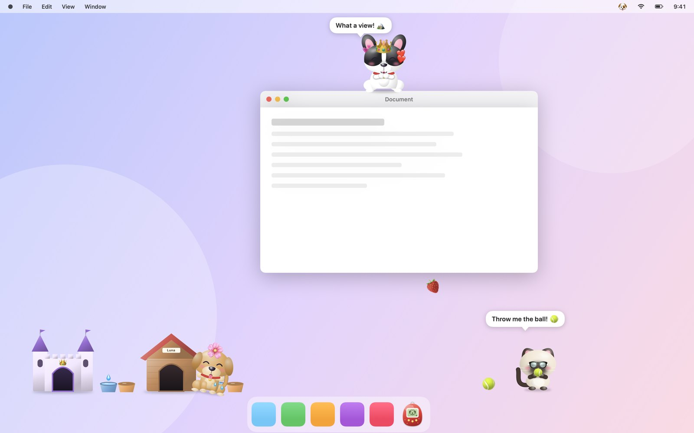</p>

- **8 species**, **45 dog breeds** in their real colours (120 combinations) and **12 cat breeds**
- **2D or 3D pets** — the same pets as real 3D models, with every breed, accessory and trick
- **61 animated tricks** with real moves and props, plus **13 mini-games**
- **28 homes** (kennels, cages, beds, palaces…), **48 accessories**, **18 scenes** you can rearrange, **13 foods**
- Up to **6 pets** living together, each with its own home on your desktop — on any of your screens
- Focus mode (pomodoro), water reminder, desktop widgets, photo mode and mood music
- **iPhone and iPad version** with home-screen widgets and a Dynamic Island timer *(coming soon)*
- Portuguese and English · light and dark theme · automatic updates

## Requirements

- macOS 14 Sonoma or later
- Apple Silicon or Intel Mac
- iPhone and iPad: iOS / iPadOS 17 or later *(coming soon — see [iPhone and iPad](#iphone-and-ipad))*

## Install

In Terminal:

```bash
curl -fsSL https://raw.githubusercontent.com/jpclopes99/PocketPup/main/install.sh | bash
```

This downloads the latest version, puts **Pocket Pup** in your Applications folder and opens it.

Or download `PocketPup.zip` from the [latest release](https://github.com/jpclopes99/PocketPup/releases/latest), unzip it and drag **Pocket Pup** to Applications. Pocket Pup is not notarized by Apple yet: if macOS says it can't be opened, open **System Settings → Privacy & Security** and click **Open Anyway** (or use the Terminal command above).

## Updates

Pocket Pup checks for new versions on its own and can install them for you. You can also use **Check for updates…** in the menu bar icon or in **Settings → About & updates**, where you can turn automatic checks and installs on or off. Every update is signed: the app only installs updates published by the author.

## First run

1. Pocket Pup opens the **Home** window and asks you to adopt your first pet: pick a species (and a breed and colour for dogs and cats) and a name. The first pet is free.
2. Your pet drops onto your screen, and its home and bowls appear at the bottom.
3. Pocket Pup lives in the **menu bar** (your pet's emoji). It has no Dock icon unless you turn it on in Settings.

## Your pet on the screen

- **Click** your pet to open its menu.
- **Drag** it to carry it around, and let go to **throw** it — it falls with real physics.
- **Move the mouse back and forth** over it to pet it.
- Its eyes **follow your mouse pointer**.
- It explores, climbs on top of your windows (and moves with them when you drag the window), and falls when you close them.
- It talks to you: good morning, when it's hungry or thirsty, when it's bored, when it climbs a window…
- **Follow me** makes it walk after your pointer; **Call pets to the pointer** (menu bar) brings them all to you.
- Clicks go through the empty space around your pet, so it never gets in the way.

## The pet menu

Click your pet (or press **⌃⌥T**) to open its menu: its status rings and twelve quick actions.

<p align="center">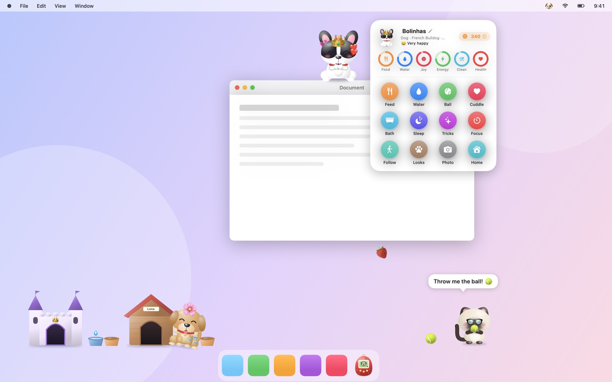</p>

| Button | What it does |
|---|---|
| **Feed** | Choose a food: it falls from the sky and your pet runs to eat it |
| **Water** | Fills the water bowl; your pet walks to it and drinks |
| **Ball** | Throws a tennis ball; your pet chases and kicks it — you can throw it too |
| **Cuddle** | Hearts and a happy pet |
| **Bath** | A bubble bath with tub, foam, shower and a good shake |
| **Sleep / Wake** | It walks to its home and sleeps inside |
| **Tricks** | Pick any of the 61 tricks |
| **Focus** | Start a 15, 25 or 50-minute focus session |
| **Follow / Stay** | Walks after your mouse pointer |
| **Looks** | Change species, breed and colour |
| **Photo** | Saves a portrait of your pet to Pictures |
| **Home** | Opens the Home window |

Click the pet's name at the top of the menu to rename it.

## Taking care of your pet

<p align="center">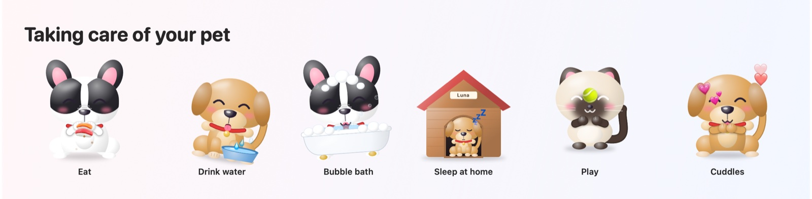</p>

| Need | What to do |
|---|---|
| 🍖 Food | **Feed** — it holds the food in its paws and eats it. Each species has a favourite food |
| 💧 Water | **Water** or click the bowl — it walks to the bowl and drinks. It also drinks on its own when thirsty |
| 🫧 Hygiene | **Bath** — bubble bath, rinse and shake |
| ⚡ Energy | **Sleep** — it walks home and sleeps inside until rested |
| 😊 Joy | **Play**, **Cuddle**, tricks and mini-games |
| ❤️ Health | Keep the other needs up; if it gets sick, give it **Medicine** (25 coins) |

Pets keep living while the app is closed (up to 8 hours) and drink from their bowl while you're away. They grow up: **Baby → Young → Adult**, and level up as you care for them.

## Homes, water and food bowls

Each pet has its own home on your desktop, with a water bowl and a food bowl next to it. **Drag the home** anywhere — even to another screen — and it settles at the bottom of the screen where you drop it (and stays there next time); **click the home** to call your pet; **click the water bowl** to fill it.

<p align="center">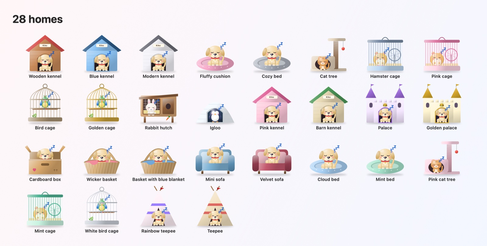</p>

Kennels, palaces, cushions, beds, cat trees, hamster cages, bird cages, a rabbit hutch, an igloo, teepees, a cardboard box, wicker baskets and sofas — each species has the homes that suit it.

## Species, breeds and colours

<p align="center">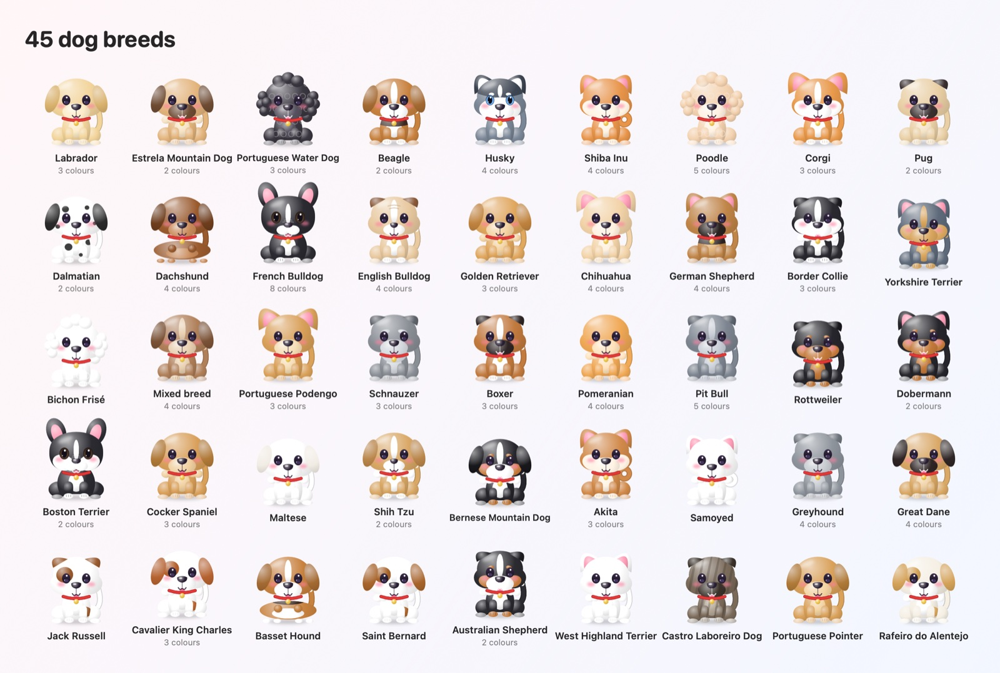</p>

- **Dogs — 45 breeds**, each in its real colours: Labrador (yellow, chocolate, black), Golden Retriever, French Bulldog (8 colours), English Bulldog, Pit Bull, Rottweiler, Dobermann, Husky, Shiba Inu, Akita, Samoyed, Corgi, Beagle, Basset Hound, Dachshund, German Shepherd, Australian Shepherd, Border Collie, Poodle, Bichon Frisé, Maltese, Shih Tzu, Pug, Chihuahua, Yorkshire, Westie, Jack Russell, Cavalier King Charles, Cocker Spaniel, Boxer, Boston Terrier, Dalmatian, Great Dane, Greyhound, Bernese Mountain Dog, Saint Bernard, Pomeranian, Schnauzer, mixed breed and the Portuguese breeds: Estrela Mountain Dog, Portuguese Water Dog, Podengo, Castro Laboreiro, Rafeiro do Alentejo and Portuguese Pointer.

<p align="center">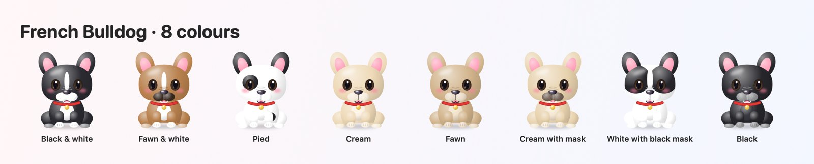</p>

<p align="center">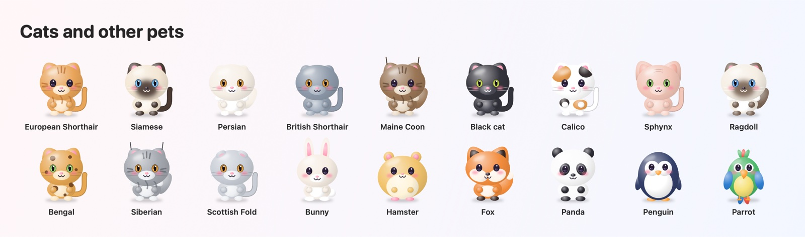</p>

- **Cats — 12 breeds**: European Shorthair, Siamese, Persian, British Shorthair, Maine Coon, black cat, Calico, Sphynx, Ragdoll, Bengal, Siberian and Scottish Fold.
- **Other pets**: bunny, hamster, fox, panda, penguin and parrot.
- **Special coats** from the shop (tiger, galaxy, rainbow, golden…) work on any pet.

You can change the species, breed and colour at any time in **Looks**: the level, accessories and diary are kept.

## 2D or 3D

Pick how your pets are drawn in **Settings → Appearance → Pet style** (or in the pet menu, under **Looks**). The 3D pets are real 3D models built from the very same shapes as the drawings — same breeds, colours, markings, accessories, expressions — with light, shadow and depth. Tricks look the same too: the guitar, the ball, the bubbles and every other prop.

<p align="center"></p>

## Tricks

<p align="center">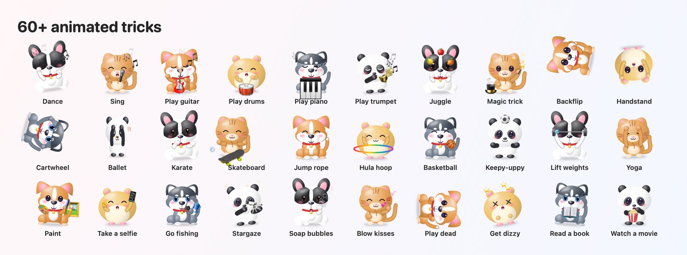</p>

61 animated tricks, each with its own moves, paws and props: dance, sing into a microphone, play the guitar, drums, piano and trumpet, juggle, a magic trick (with a rabbit out of the hat), backflip, handstand, cartwheel, ballet, moonwalk, karate, skateboard, jump rope, hula hoop, basketball, keepy-uppy, lift weights, yoga, paint, take a selfie, go fishing, stargaze, soap bubbles, blow kisses, high five, take a bow, beg, shake paws, play dead, chase its tail and many more. Your pet also does many of them on its own, depending on its mood.

## Mini-games and coins

13 mini-games: **Catch the Food**, **Memory**, **Rock-Paper-Scissors**, **Tap the Pet**, **Bubble Pop**, **Pet Run**, **Sequence**, **Find the Pet**, **Snake**, **Brick Breaker**, **Tic-Tac-Toe** against your pet, **Slide Puzzle** and **Fly**.

<p align="center">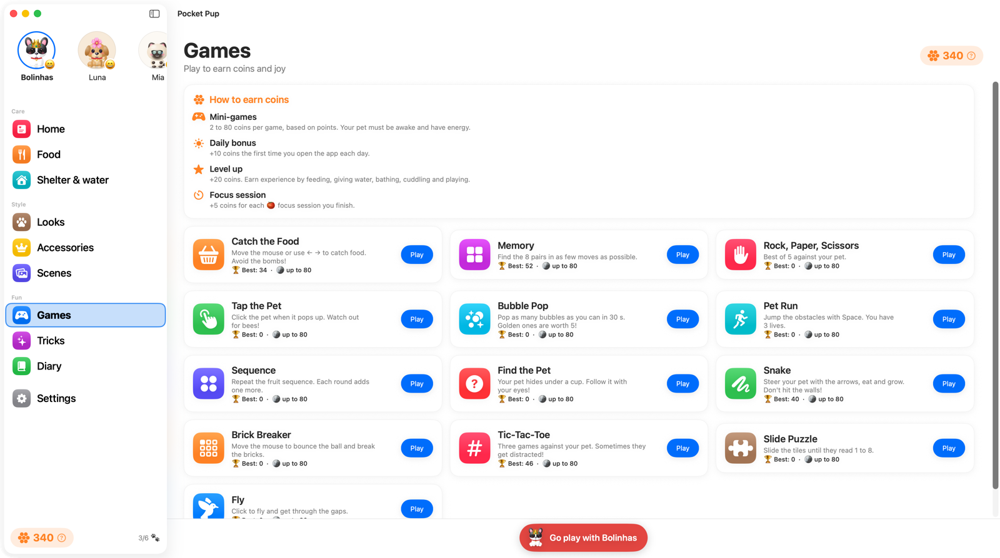</p>

| How to earn coins | |
|---|---|
| Mini-games | 2 to 80 coins per game, based on your score |
| Daily bonus | 10 coins the first time you open the app each day |
| Level up | 20 coins |
| Focus session | 5 coins for each finished 🍅 session |

Spend them on food, accessories, special coats, homes, scenes, medicine and on adopting more pets (up to 6). Click the coin counter anywhere in the app for the full explanation.

## The Home window

Open it from the pet menu, the menu bar or with **⌃⌥C**.

<p align="center">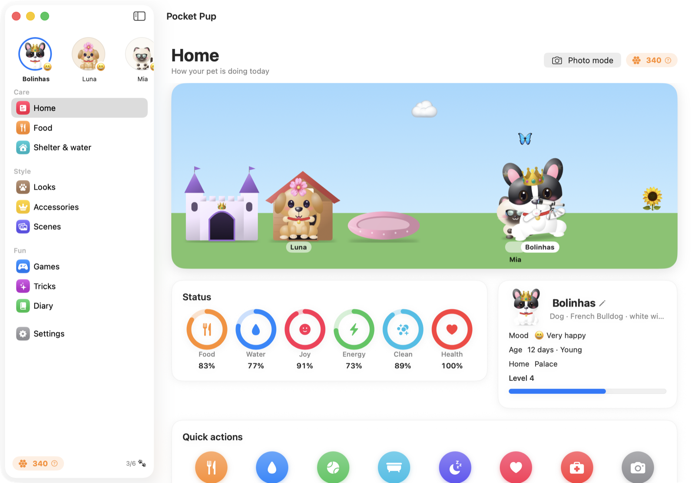</p>

| Section | |
|---|---|
| **Home** | The room with all your pets and their homes, status rings, the pet card (click the name to rename) and quick actions |
| **Food** | Feed your pet and buy more food; favourites are marked |
| **Shelter & water** | The water bowl, homes on the screen and all the homes for your species |
| **Looks** | Species, breed, colour and special coats |
| **Accessories** | 48 accessories for the head, face, neck and paw |
| **Scenes** | 18 backdrops for the room — and the scene editor |
| **Games** | The 13 mini-games and how to earn coins |
| **Tricks** | Ask for any of the 61 tricks |
| **Diary** | Everything that happens, day by day, plus your own notes |
| **Settings** | Language, theme, shortcuts, companion, reminders, music, widgets, updates and licenses |

<table>
  <tr>
    <td>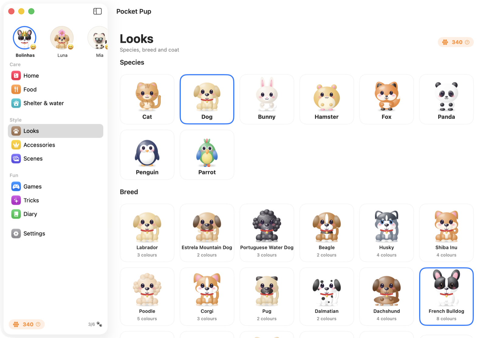</td>
    <td>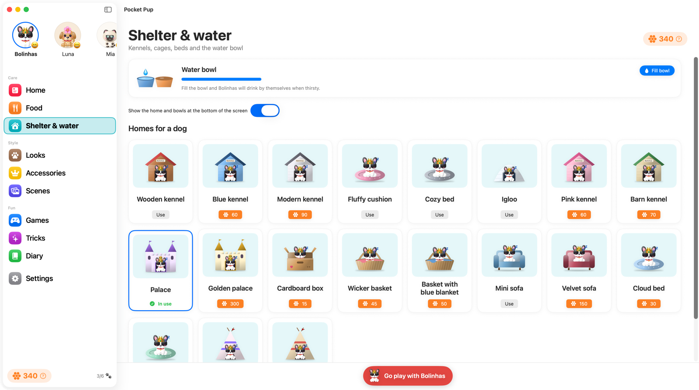</td>
  </tr>
  <tr>
    <td>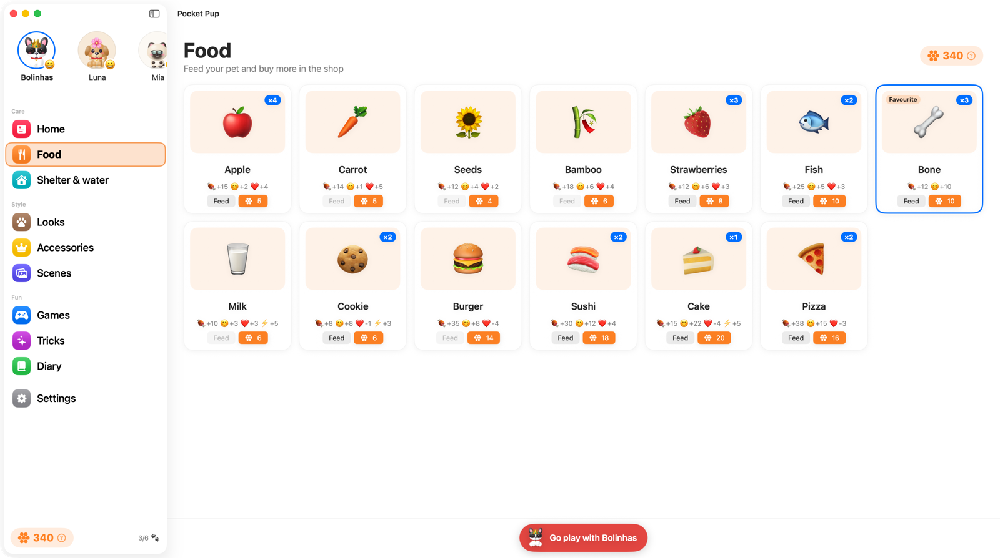</td>
    <td>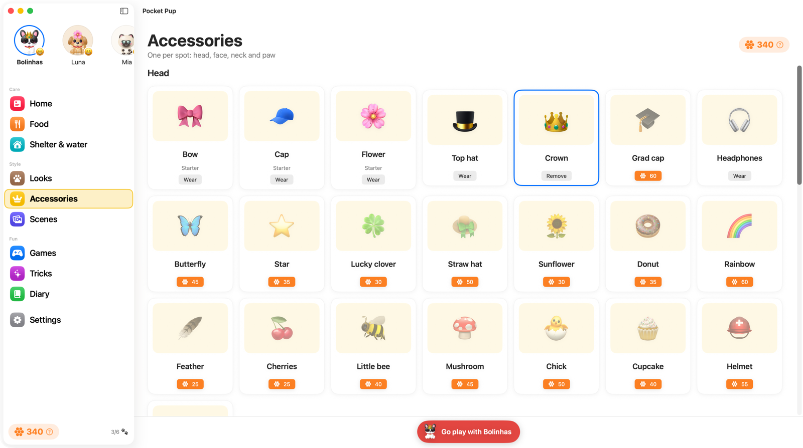</td>
  </tr>
  <tr>
    <td>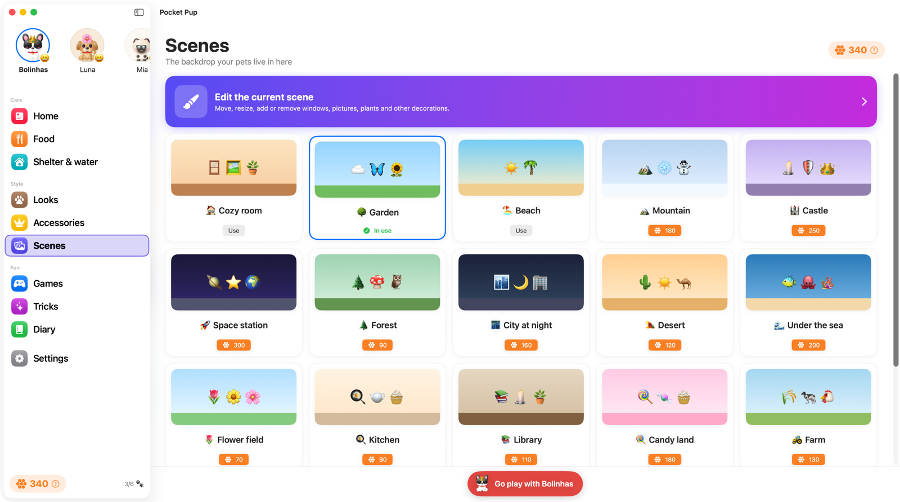</td>
    <td>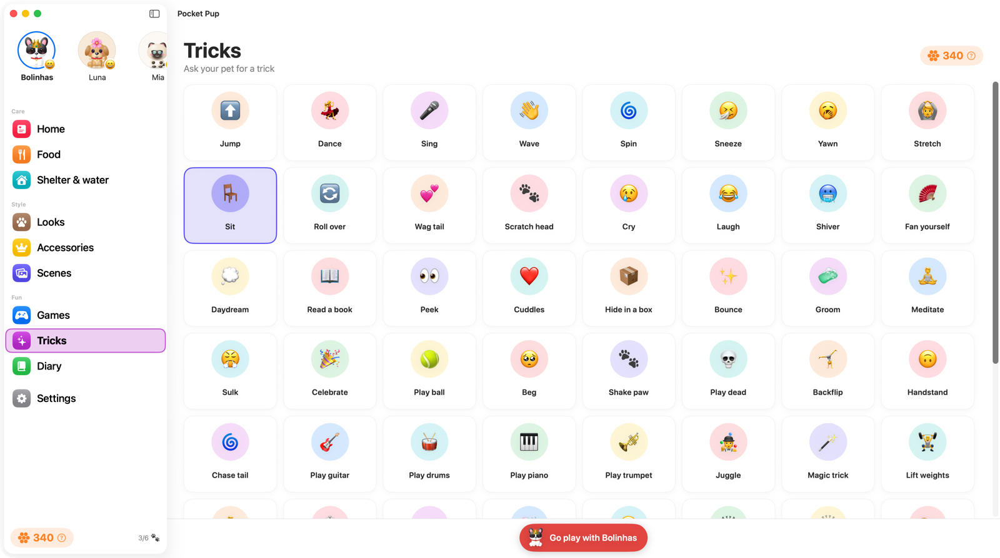</td>
  </tr>
  <tr>
    <td>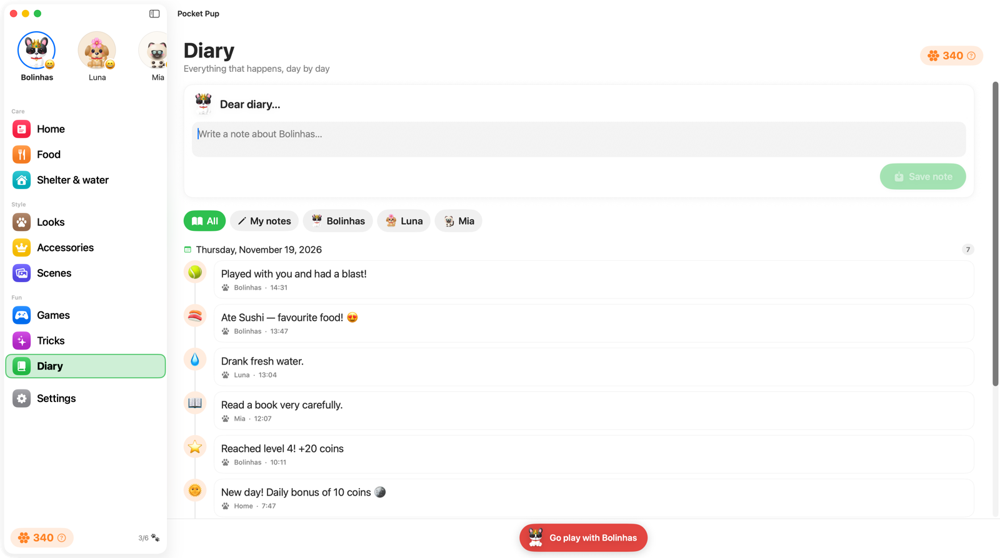</td>
    <td>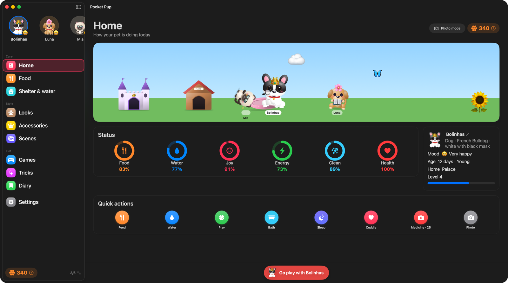</td>
  </tr>
</table>

The pet switcher at the top of the sidebar can be dragged sideways when you have many pets, and **Go play with…** at the bottom closes the window and calls your pets to the pointer.

There is also a **photo mode** (filters, frames and a caption) that saves pictures of the room to your Pictures folder.

## Scene editor

Make the room yours: in **Scenes**, click **Edit the current scene**. Drag any piece (window, picture, plants…) wherever you like, make it bigger or smaller, delete it, or add new ones — clocks, lamps, books, a guitar, a mirror, balloons, rainbows and more. **Reset** brings back the original scene; each scene keeps its own layout.

<p align="center">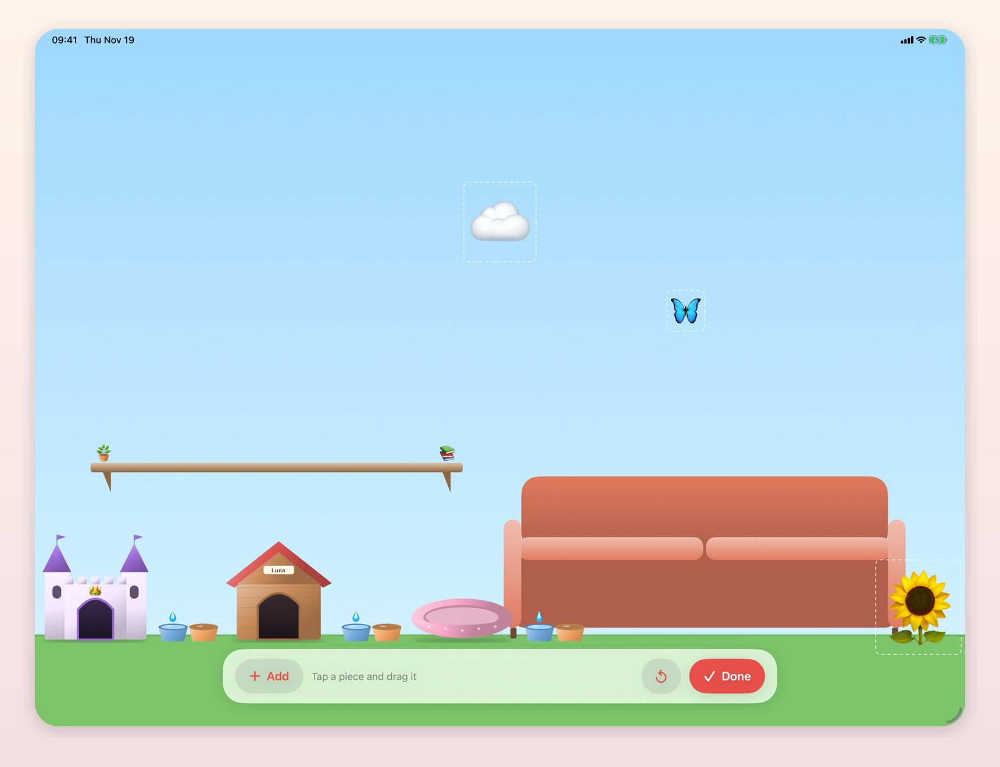</p>

## Focus mode and reminders

- **Focus** — your pet sits next to you reading while you work (15, 25 or 50 minutes, with a timer above it) and tells you when it's break time. Each finished session gives 5 coins.
- **Water reminder** — every 45 minutes your pet reminds you to drink water too.
- **Desktop widgets** — an animated pet, the status of all your pets and the latest diary pages, on your desktop.
- **Mood music** — optional soft music that changes with your pet's mood.

## Keyboard shortcuts

| | |
|---|---|
| **⌃⌥T** | Open or close the pet menu (works in any app) |
| **⌃⌥C** | Open the Home window (works in any app) |

You can change both in **Settings → Keyboard shortcuts**: click **Change** and press the new combination (it must include ⌘, ⌥ or ⌃; Esc cancels).

## Settings

<p align="center">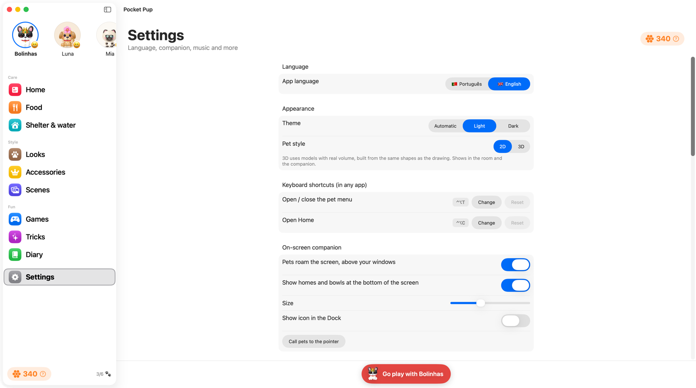</p>

Language (Português / English) · theme (automatic, light, dark) · pet style (2D or 3D) · keyboard shortcuts · pets on screen · homes and bowls on screen · pet size · Dock icon · water reminder · mood music · desktop widgets · rename or release the selected pet · about & updates · credits and licenses.

## iPhone and iPad

> **Coming soon.** The iPhone and iPad version is ready and being tested; it isn't on the App Store yet. Follow this repository (or the [releases](https://github.com/jpclopes99/PocketPup/releases)) to know when it's out.

iPhone and iPad don't let apps float above other apps, so on iOS your pets live in their own **room** inside the app — and outside it, in **widgets**, the **Dynamic Island** and **notifications**. Everything else is the same as on the Mac: the Home window, the 13 mini-games, tricks, breeds and colours, accessories, scenes, the diary, photo mode, 2D or 3D, Portuguese and English and dark mode.

<p align="center">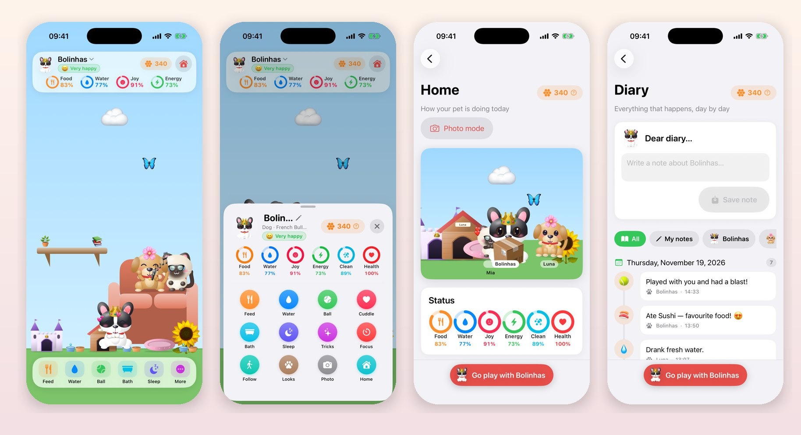</p>

- **The room** — your pets walk, climb the sofa and the shelf, sleep in their homes and drink from their bowls. **Tap** a pet to open its menu, **double-tap** to cuddle it, **drag** it to carry it and **flick** it to throw it. The bar at the top shows its mood and needs; the bar at the bottom feeds, waters, plays, bathes and puts it to bed in one tap.
- **The pet menu** — the same twelve actions as on the Mac, in a sheet.
- **Home** — every section of the Mac's Home window. **Go play with…** takes you back to the room.
- **Haptics and touch** — every mini-game works with taps, drags and swipes.

<p align="center">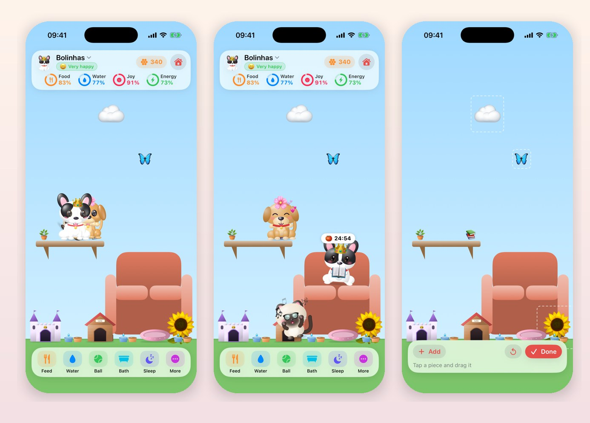</p>

**On iPad**, the room and all controls are bigger, and the Home window uses a sidebar like on the Mac.

<p align="center">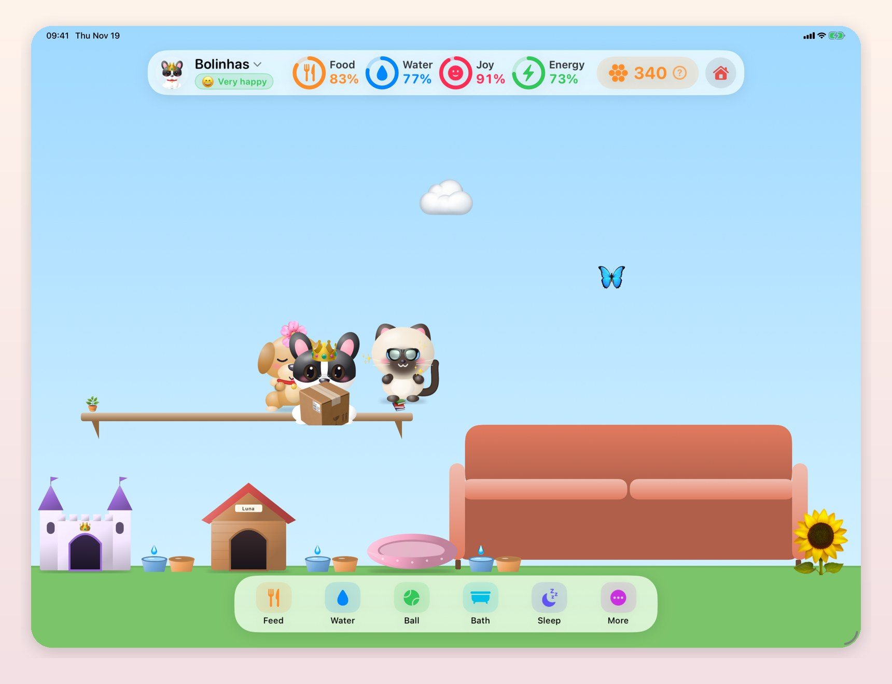</p>

<p align="center">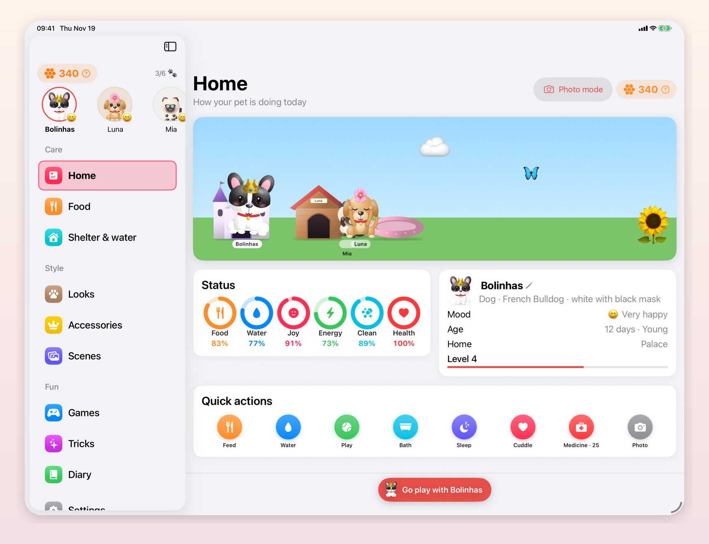</p>

**Widgets, Dynamic Island and notifications**

- **Home-screen widgets** (small, medium and large) show your pet, its mood and needs, with buttons to **feed**, **give water**, **cuddle** and **sleep** without opening the app. Tap the pet's name to **pick another pet** from the list. Lock Screen widgets too.
- **Focus mode** shows the countdown on the **Lock Screen** and in the **Dynamic Island**.
- **Notifications** tell you when your pet is getting hungry, thirsty, sleepy or dirty, and when a focus session ends (you can turn them off in Settings).

<p align="center">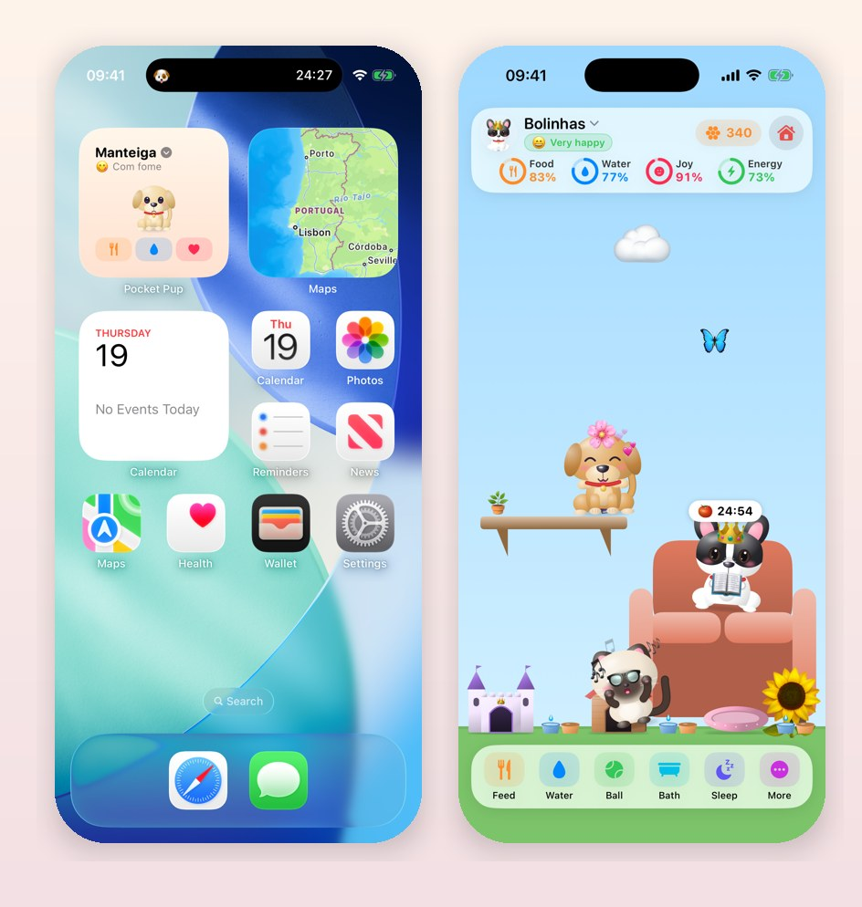</p>

## Privacy

Pocket Pup runs on your Mac. It has no account, no ads and no analytics.

| Data | Where it stays |
|---|---|
| Pets, coins, diary and settings | Only on your Mac, in `~/Library/Application Support/Pocket Pup/` (on iPhone and iPad, only on the device, shared with the widgets) |
| Photos you take | `~/Pictures/Pocket Pup/` |
| Update check | Asks GitHub for the list of versions and downloads the update. No personal data is sent |

## Troubleshooting

- **macOS says Pocket Pup can't be opened** — install it with the Terminal command above, or open **System Settings → Privacy & Security** and click **Open Anyway**.
- **I can't move a home to my other screen** — drag the home itself (not the bowls) and let go over the other screen; it settles at the bottom of that screen.
- **I can't see my pet** — check that **Pets on screen** is on in the menu bar icon, or use **Call pets to the pointer**. If it's asleep, it's inside its home.
- **I can't play mini-games** — your pet needs to be awake and have at least 10% energy.
- **A shortcut doesn't work** — another app may use the same combination; change it in **Settings → Keyboard shortcuts**.
- **I want to start over** — quit Pocket Pup and delete `~/Library/Application Support/Pocket Pup/`.

## Acknowledgements

Pocket Pup uses this open-source component (full notice in [THIRD_PARTY_NOTICES.txt](THIRD_PARTY_NOTICES.txt) and in the app: **Settings → Credits and licenses**):

| | | License |
|---|---|---|
| [Sparkle](https://sparkle-project.org) | Automatic updates | MIT |

## Feedback

Found a bug or have an idea? **[Open an issue](https://github.com/jpclopes99/PocketPup/issues)** — problems are fixed and new features ship in new releases.

## Trademarks

Tamagotchi is a registered trademark of Bandai Co., Ltd. Pocket Pup is an independent project and is not affiliated with, endorsed or sponsored by Bandai. Apple, Mac and macOS are trademarks of Apple Inc., registered in the U.S. and other countries.

## License

**All rights reserved.** Pocket Pup is free to download, install and use on your own Macs, but it is **not open source**: the source code is not published, and you may not copy, modify or redistribute the app without the author's written permission. The software is provided "as is", without warranty. See [LICENSE](LICENSE) for the full terms. Third-party components are not covered by it and keep their own licenses: [Sparkle](https://sparkle-project.org) (MIT). See [Acknowledgements](#acknowledgements).

© 2026 João Lopes
