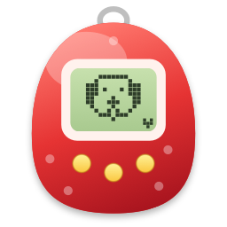
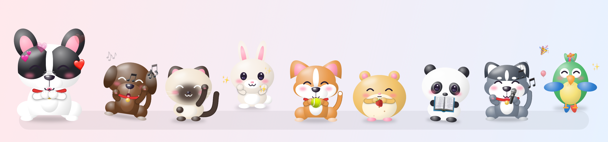

<p align="center"></p>

<h1 align="center">Pocket Pup</h1>

<p align="center">
  <b>A free virtual pet that lives on your Mac.</b><br>
  A puppy (or cat, bunny, hamster, fox, panda, penguin or parrot) that walks on your screen, climbs your windows and needs your care.
</p>

<p align="center"></p>

<p align="center">🇵🇹 <a href="docs/LEIA-ME.pt.md">Ler em português</a></p>

---

## Contents

- [What is Pocket Pup?](#what-is-pocket-pup)
- [Requirements](#requirements)
- [Install](#install)
- [Updates](#updates)
- [First run](#first-run)
- [Your pet on the screen](#your-pet-on-the-screen)
- [Taking care of your pet](#taking-care-of-your-pet)
- [Species, breeds and colours](#species-breeds-and-colours)
- [Tricks](#tricks)
- [Mini-games and coins](#mini-games-and-coins)
- [Home window](#home-window)
- [Keyboard shortcuts](#keyboard-shortcuts)
- [Privacy](#privacy)
- [Troubleshooting](#troubleshooting)
- [Acknowledgements](#acknowledgements)
- [Feedback](#feedback)
- [Trademarks](#trademarks)
- [License](#license)

## What is Pocket Pup?

Pocket Pup is a desktop companion inspired by the classic virtual pets. Your pet doesn't live in a window: it walks along the bottom of your screen, jumps on top of your windows, sleeps in its own kennel or cage, drinks from its water bowl and talks to you in little speech bubbles. It gets hungry, thirsty, tired and dirty, and it's happy when you play with it.

- **8 species**, **45 dog breeds** in their real colours (120 combinations) and **12 cat breeds**
- **61 animated tricks**, from playing the guitar to backflips, plus **13 mini-games**
- **28 homes** (kennels, cages, beds, palaces…), **48 accessories**, **18 scenes**
- Focus mode (pomodoro), water reminder, desktop widgets and mood music
- Portuguese and English · light and dark theme · automatic updates

## Requirements

- macOS 14 Sonoma or later
- Apple Silicon or Intel Mac

## Install

In Terminal:

```bash
curl -fsSL https://raw.githubusercontent.com/jpclopes99/PocketPup/main/install.sh | bash
```

This downloads the latest version, puts **Pocket Pup** in your Applications folder and opens it.

Or download `PocketPup.zip` from the [latest release](https://github.com/jpclopes99/PocketPup/releases/latest), unzip it and drag **Pocket Pup** to Applications. Pocket Pup is not notarized by Apple yet: if macOS says it can't be opened, open **System Settings → Privacy & Security** and click **Open Anyway** (or use the Terminal command above).

## Updates

Pocket Pup checks for new versions on its own and installs them for you. You can also use **Check for updates…** in the menu bar icon or in **Settings → About & updates**. Every update is signed: the app only installs updates published by the author.

## First run

1. Pocket Pup opens the **Home** window and asks you to adopt your first pet: pick a species (and a breed and colour for dogs and cats) and a name.
2. Your pet drops onto your screen and its home and bowls appear at the bottom.
3. Pocket Pup lives in the **menu bar** (the pet's emoji). It has no Dock icon unless you turn it on in Settings.

## Your pet on the screen

- **Click** your pet to open its menu.
- **Drag** it to carry it around, and let go to **throw** it.
- **Move the mouse back and forth** over it to pet it.
- It explores, climbs on top of your windows (and moves with them), and falls if you close them.
- It talks to you: good morning, when it's hungry or thirsty, when it's bored…
- **Follow me** makes it walk after your mouse pointer; **Call pets to the pointer** brings them all to you.

## Taking care of your pet

| Need | What to do |
|---|---|
| 🍖 Food | **Feed**: the food falls from the sky and your pet runs to eat it, holding it in its paws |
| 💧 Water | **Water** (or click the water bowl): it walks to the bowl and drinks. It also drinks on its own when it's thirsty |
| 🫧 Hygiene | **Bath**: bubble bath with a tub, foam, shower and a good shake at the end |
| ⚡ Energy | **Sleep**: it walks to its home and sleeps inside until it's rested |
| 😊 Joy | **Play**, **Cuddle**, tricks and mini-games |
| ❤️ Health | Keep the other needs up; if it gets sick, give it **Medicine** |

Each pet has its own home on the desktop (kennel, cage, bed, igloo, palace…), which you can drag anywhere along the bottom of the screen. Pets keep living while the app is closed (up to 8 hours), so remember to come back.

## Species, breeds and colours

- **Dogs** — 45 breeds, each with its real colours: Labrador, Golden Retriever, French Bulldog (8 colours), English Bulldog, Pit Bull, Rottweiler, Dobermann, Husky, Shiba Inu, Corgi, Beagle, Dachshund, German Shepherd, Border Collie, Poodle, Pug, Chihuahua, Yorkshire, Boxer, Dalmatian, Great Dane, Cavalier King Charles, Portuguese breeds (Estrela Mountain Dog, Portuguese Water Dog, Podengo, Castro Laboreiro, Rafeiro do Alentejo, Portuguese Pointer) and many more.
- **Cats** — 12 breeds, including Siamese, Persian, Maine Coon, British Shorthair, Ragdoll, Bengal and Sphynx.
- **Other pets** — bunny, hamster, fox, panda, penguin and parrot.

You can change the species, breed and colour at any time: the level, accessories and diary are kept.

## Tricks

61 animated tricks with their own moves and props: dance, sing into a microphone, play the guitar, drums, piano and trumpet, juggle, magic (with a rabbit out of the hat), backflip, handstand, cartwheel, ballet, moonwalk, karate, skateboard, jump rope, hula hoop, basketball, keepy-uppy, fishing, stargazing, blow kisses, play dead and more. Your pet also does many of them on its own.

## Mini-games and coins

13 mini-games: Catch the Food, Memory, Rock-Paper-Scissors, Tap the Pet, Bubble Pop, Pet Run, Sequence, Find the Pet, Snake, Brick Breaker, Tic-Tac-Toe against your pet, Slide Puzzle and Fly.

| How to earn coins | |
|---|---|
| Mini-games | 2 to 80 coins per game, based on your score |
| Daily bonus | 10 coins the first time you open the app each day |
| Level up | 20 coins |
| Focus session | 5 coins for each finished 🍅 session |

Spend them on food, accessories, special coats, homes, scenes, medicine and on adopting more pets (up to 6). Click the coin counter anywhere in the app for the full explanation.

## Home window

Open it from the pet menu, the menu bar or with **⌃⌥C**. It has: Home (status, quick actions and the room), Food, Shelter & water, Looks (species, breed, colour, special coats), Accessories, Scenes, Games, Tricks, Diary and Settings. To rename a pet, just click its name.

## Keyboard shortcuts

| | |
|---|---|
| **⌃⌥T** | Open or close the pet menu (works in any app) |
| **⌃⌥C** | Open the Home window (works in any app) |

You can change both in **Settings → Keyboard shortcuts**.

## Privacy

Pocket Pup runs on your Mac. It has no account, no ads and no analytics.

- Your pets, coins and diary are saved only on your Mac, in `~/Library/Application Support/Pocket Pup/`.
- Photos you take are saved in `~/Pictures/Pocket Pup/`.
- The only connection to the internet is the update check, which asks GitHub for the list of versions and downloads the update itself. No personal data is sent.

## Troubleshooting

- **macOS says Pocket Pup can't be opened** — install it with the Terminal command above, or open **System Settings → Privacy & Security** and click **Open Anyway**.
- **I can't see my pet** — check that **Pets on screen** is on in the menu bar icon, or use **Call pets to the pointer**.
- **My pet is asleep in its home** — it wakes up when it's rested; you can also wake it from its menu.
- **I can't play mini-games** — your pet needs to be awake and have at least 10% energy.

## Acknowledgements

Pocket Pup uses this open-source component (full notice in [THIRD_PARTY_NOTICES.txt](THIRD_PARTY_NOTICES.txt) and in the app: **Settings → Credits and licenses**):

| | | License |
|---|---|---|
| [Sparkle](https://sparkle-project.org) | Automatic updates | MIT |

## Feedback

Found a bug or have an idea? **[Open an issue](https://github.com/jpclopes99/PocketPup/issues)**.

## Trademarks

Tamagotchi is a registered trademark of Bandai Co., Ltd. Pocket Pup is an independent project and is not affiliated with, endorsed or sponsored by Bandai. Apple, Mac and macOS are trademarks of Apple Inc., registered in the U.S. and other countries.

## License

**All rights reserved.** Pocket Pup is free to download, install and use on your own Macs, but it is **not open source**: the source code is not published, and you may not copy, modify or redistribute the app without the author's written permission. The software is provided "as is", without warranty. See [LICENSE](LICENSE) for the full terms. Third-party components are not covered by it and keep their own licenses: [Sparkle](https://sparkle-project.org) (MIT). See [Acknowledgements](#acknowledgements).

© 2026 João Lopes
