<p align="center">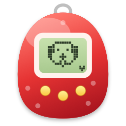</p>

<h1 align="center">Pocket Pup</h1>

<p align="center">
  <b>Um bichinho virtual gratuito que vive no teu Mac — e agora também no iPhone e no iPad.</b><br>
  Um cãozinho (ou gato, coelho, hamster, raposa, panda, pinguim ou papagaio) que passeia pelo ecrã, sobe às tuas janelas e precisa dos teus cuidados. Em 2D ou 3D.
</p>

<p align="center">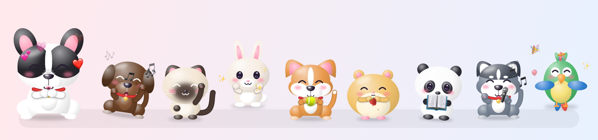</p>

<p align="center">
  <a href="https://github.com/jpclopes99/PocketPup/releases/latest"><b>⬇️ Descarregar a última versão</b></a> ·
  🇬🇧 <a href="../README.md">Read in English</a>
</p>

---

## Índice

- [Vídeos](#vídeos)
- [O que é o Pocket Pup?](#o-que-é-o-pocket-pup)
- [Requisitos](#requisitos)
- [Instalar](#instalar)
  - [Mac](#instalar-no-mac)
  - [iPhone e iPad](#instalar-no-iphone-e-no-ipad)
- [Atualizações](#atualizações)
- [Primeira vez](#primeira-vez)
- [O teu pet no ecrã](#o-teu-pet-no-ecrã)
- [O menu do pet](#o-menu-do-pet)
- [Cuidar do pet](#cuidar-do-pet)
- [Abrigos, taça de água e comida](#abrigos-taça-de-água-e-comida)
- [Espécies, raças e cores](#espécies-raças-e-cores)
- [2D ou 3D](#2d-ou-3d)
- [Truques](#truques)
- [Mini-jogos e moedas](#mini-jogos-e-moedas)
- [A janela Casa](#a-janela-casa)
- [Editor de cenários](#editor-de-cenários)
- [Modo foco e lembretes](#modo-foco-e-lembretes)
- [Atalhos de teclado](#atalhos-de-teclado)
- [Definições](#definições)
- [iPhone e iPad](#iphone-e-ipad)
- [Privacidade](#privacidade)
- [Resolução de problemas](#resolução-de-problemas)
- [Agradecimentos](#agradecimentos)
- [Sugestões e erros](#sugestões-e-erros)
- [Marcas registadas](#marcas-registadas)
- [Licença](#licença)

## Vídeos

| Mac (46 s) | iPhone (73 s) |
|:---:|:---:|
| <a href="video/pocketpup-mac.mp4">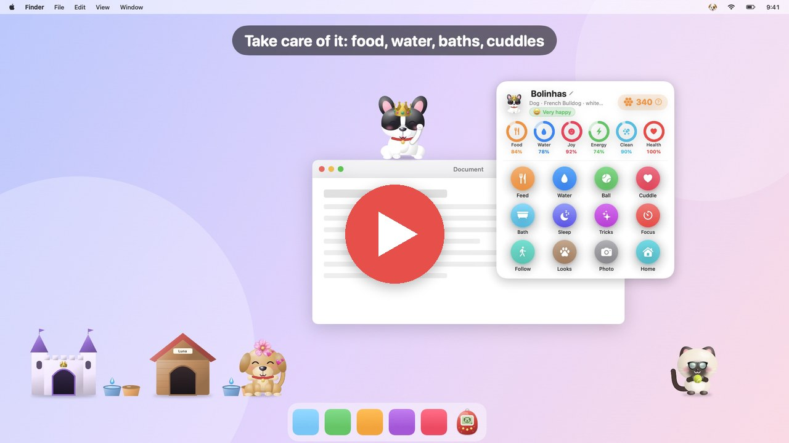</a> | <a href="video/pocketpup-iphone.mp4">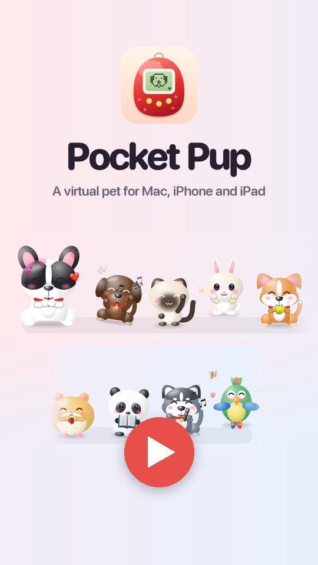</a> |

<p align="center"><a href="video/pocketpup-mac-iphone.mp4"><b>▶︎ Ver o Mac e o iPhone juntos (86 s)</b></a></p>

Os vídeos estão em inglês.

## O que é o Pocket Pup?

O Pocket Pup é um companheiro de secretária inspirado nos bichinhos virtuais clássicos. O teu pet não vive numa janela: passeia pelo fundo do ecrã, salta para cima das tuas janelas, dorme na sua casota ou gaiola, bebe da taça de água e fala contigo em balões. Tem fome, sede, sono e fica sujo, e fica contente quando brincas com ele.

<p align="center">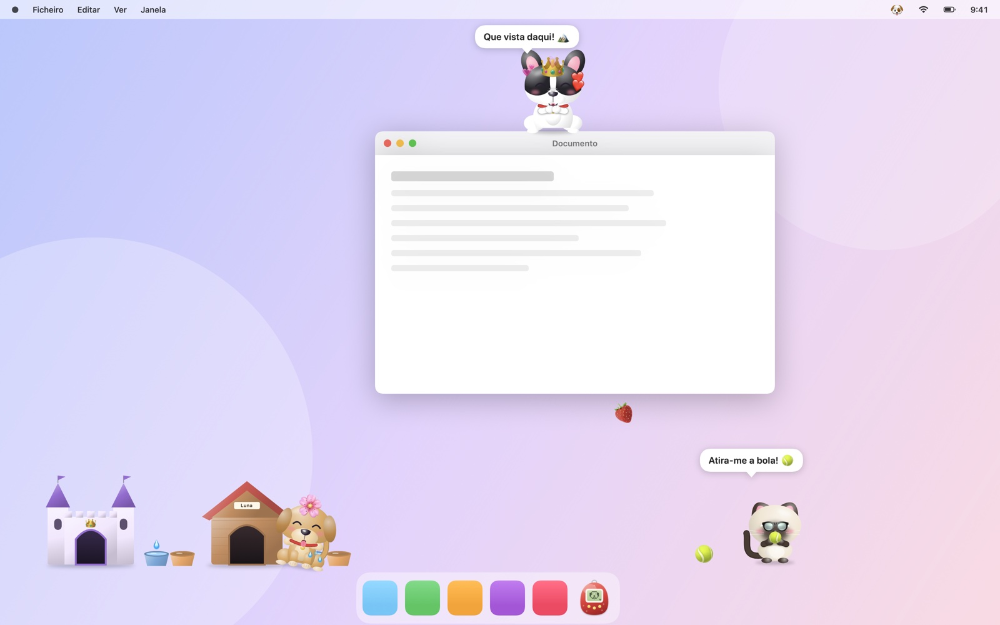</p>

- **8 espécies**, **45 raças de cão** nas cores reais (120 combinações) e **12 raças de gato**
- **Pets em 2D ou 3D** — os mesmos pets como modelos 3D a sério, com todas as raças, acessórios e truques
- **61 truques animados** com movimentos e objetos a sério, e **13 mini-jogos**
- **28 abrigos** (casotas, gaiolas, camas, palácios…), **48 acessórios**, **18 cenários** que podes arrumar à tua maneira, **13 comidas**
- Até **6 pets** a viver juntos, cada um com o seu abrigo na secretária — em qualquer um dos teus ecrãs
- Modo foco (pomodoro), lembrete para beber água, widgets de secretária, modo foto e música do humor
- **Versão para iPhone e iPad** com widgets no ecrã principal, contagem na Dynamic Island e notificações
- Português e English · tema claro e escuro · atualizações automáticas

## Requisitos

- macOS 14 Sonoma ou mais recente
- Mac com Apple Silicon ou Intel
- iPhone e iPad: iOS / iPadOS 17 ou mais recente, instalado com o [AltStore ou o SideStore](#instalar-no-iphone-e-no-ipad) e um Apple ID gratuito

## Instalar

| | Ficheiro | Como |
|---|---|---|
| **Mac** | `PocketPup.zip` | Um comando no Terminal — [Mac](#instalar-no-mac) |
| **iPhone e iPad** | `PocketPup.ipa` | Com o AltStore ou o SideStore, com o teu Apple ID — [iPhone e iPad](#instalar-no-iphone-e-no-ipad) |

Estão os dois na [última versão](https://github.com/jpclopes99/PocketPup/releases/latest).

### Instalar no Mac

No Terminal:

```bash
curl -fsSL https://raw.githubusercontent.com/jpclopes99/PocketPup/main/install.sh | bash
```

Isto descarrega a última versão, põe o **Pocket Pup** nas Aplicações e abre-o.

Também podes descarregar o `PocketPup.zip` da [última versão](https://github.com/jpclopes99/PocketPup/releases/latest), descomprimir e arrastar o **Pocket Pup** para as Aplicações. O Pocket Pup ainda não é notarizado pela Apple: se o macOS disser que não o pode abrir, vai a **Definições do Sistema → Privacidade e Segurança** e carrega em **Abrir mesmo assim** (ou usa o comando do Terminal acima).

### Instalar no iPhone e no iPad

O Pocket Pup não está na App Store. Instalas o `PocketPup.ipa` com o **[AltStore](https://altstore.io)**, uma app gratuita que o assina com o **teu próprio Apple ID** — sem jailbreak e sem pagar nada. Precisas de um Mac (ou PC com Windows) para a primeira configuração e, de tantos em tantos dias, para manter a app assinada.

**1. Preparar o AltStore (uma vez)**

1. No Mac, descarrega o **AltServer** em [altstore.io](https://altstore.io), move-o para as Aplicações e abre-o. Aparece na barra de menus (um ícone em forma de losango).
2. Liga o iPhone ou o iPad ao Mac com um cabo, desbloqueia-o e toca em **Confiar** quando te perguntar.
3. No **Finder**, escolhe o iPhone na barra lateral, liga **Mostrar este iPhone quando estiver em Wi-Fi** e carrega em **Aplicar**. Assim o AltStore consegue renovar as apps sem o cabo.
4. Clica no ícone do AltServer na barra de menus › **Install AltStore** › o teu iPhone. Inicia sessão com o teu **Apple ID** (só é enviado à Apple, para assinar as apps).
5. No iPhone, abre **Definições › Geral › VPN e gestão de dispositivos**, toca no teu Apple ID em *App de programador* e toca em **Confiar**.
6. No iOS 16 ou mais recente, liga **Definições › Privacidade e segurança › Modo de programador**, reinicia quando pedir e confirma **Ativar**.

**2. Instalar o Pocket Pup**

1. No iPhone, abre a [última versão](https://github.com/jpclopes99/PocketPup/releases/latest) no Safari e toca em `PocketPup.ipa` › **Descarregar**.
2. Abre o **AltStore** › **My Apps** › **+** (em cima à esquerda), vai a **Transferências** e escolhe o `PocketPup.ipa`. O AltServer tem de estar aberto no Mac, na mesma rede Wi-Fi (ou com o cabo ligado).
3. O Pocket Pup aparece no ecrã principal. Abre-o, adota o primeiro pet e permite as **notificações** se quiseres saber quando ele precisa de ti.
4. Para pôr o widget: mantém premido o ecrã principal › **Editar** › **Adicionar widget** › **Pocket Pup**.

**3. Manter a funcionar**

- As apps assinadas com um Apple ID gratuito **expiram ao fim de 7 dias**. O AltStore renova-as em segundo plano sempre que o iPhone e o Mac com o AltServer estão na mesma rede Wi-Fi; também podes abrir o AltStore › **My Apps** › **Refresh All**. Se o Pocket Pup expirar, não abre até o renovares — os teus pets ficam guardados.
- **Atualizar**: descarrega o novo `PocketPup.ipa` e instala-o da mesma forma; substitui o anterior e mantém os teus pets.
- Um Apple ID gratuito pode ter **3 apps instaladas assim** ao mesmo tempo (o próprio AltStore conta como uma).
- Preferes não usar um computador? O [SideStore](https://sidestore.io) faz o mesmo a partir do próprio iPhone, depois de uma configuração inicial com um computador.
- **Desinstalar**: mantém premido o Pocket Pup no ecrã principal › **Remover app** › **Apagar app**.

## Atualizações

No **Mac**, o Pocket Pup procura versões novas sozinho e pode instalá-las por ti. Também podes usar **Procurar atualizações…** no ícone da barra de menus ou em **Definições → Sobre e atualizações**, onde ligas ou desligas a procura e a instalação automáticas. Todas as atualizações são assinadas: a app só instala as que são publicadas pelo autor.

No **iPhone e no iPad**, instala o novo `PocketPup.ipa` da [última versão](https://github.com/jpclopes99/PocketPup/releases/latest) com o AltStore (ver acima); os teus pets mantêm-se.

## Primeira vez

1. O Pocket Pup abre a janela **Casa** e pede-te para adotares o primeiro pet: escolhe a espécie (e a raça e a cor, nos cães e gatos) e o nome. O primeiro pet é grátis.
2. O pet cai no teu ecrã, e o abrigo e as taças aparecem no fundo.
3. O Pocket Pup vive na **barra de menus** (o emoji do teu pet). Não tem ícone na Dock, a não ser que o ligues nas Definições.

## O teu pet no ecrã

- **Clica** no pet para abrir o menu.
- **Arrasta-o** para o levares e larga-o para o **atirares** — cai com física a sério.
- **Passa o rato para a frente e para trás** por cima dele para lhe fazeres festas.
- Os olhos dele **seguem o rato**.
- Explora, sobe para cima das tuas janelas (e anda com elas quando as arrastas) e cai quando as fechas.
- Fala contigo: dá os bons-dias, diz quando tem fome ou sede, quando está aborrecido, quando sobe a uma janela…
- **Segue-me** põe-no a andar atrás do rato; **Chamar os pets para o rato** (barra de menus) traz todos até ti.
- Os cliques passam pelo espaço vazio à volta do pet, por isso nunca te atrapalha.

## O menu do pet

Clica no pet (ou carrega em **⌃⌥T**) para abrires o menu: os anéis do estado e doze ações rápidas.

<p align="center"></p>

| Botão | O que faz |
|---|---|
| **Comer** | Escolhes a comida: cai do céu e o pet corre para a comer |
| **Água** | Enche a taça; o pet vai lá e bebe |
| **Bola** | Atira uma bola de ténis; o pet persegue-a e dá-lhe pontapés — também a podes atirar |
| **Mimos** | Corações e um pet feliz |
| **Banho** | Banho de espuma com banheira, chuveiro e uma boa sacudidela |
| **Dormir / Acordar** | Vai a pé até ao abrigo e dorme lá dentro |
| **Truques** | Escolhe qualquer um dos 61 truques |
| **Foco** | Começa uma sessão de foco de 15, 25 ou 50 minutos |
| **Segue-me / Fica** | Anda atrás do rato |
| **Aparência** | Muda a espécie, a raça e a cor |
| **Foto** | Guarda um retrato do pet nas Imagens |
| **Casa** | Abre a janela Casa |

Carrega no nome do pet no topo do menu para lhe mudares o nome.

## Cuidar do pet

<p align="center"></p>

| Necessidade | O que fazer |
|---|---|
| 🍖 Fome | **Comer** — segura a comida nas patas e come-a. Cada espécie tem uma comida favorita |
| 💧 Sede | **Água** ou clica na taça — vai à taça e bebe. Também bebe sozinho quando tem sede |
| 🫧 Higiene | **Banho** — espuma, chuveiro e sacudidela |
| ⚡ Energia | **Dormir** — vai a pé até ao abrigo e dorme lá dentro até descansar |
| 😊 Alegria | **Brincar**, **Mimos**, truques e mini-jogos |
| ❤️ Saúde | Mantém as outras necessidades em dia; se ficar doente, dá-lhe um **Remédio** (25 moedas) |

Os pets continuam a viver com a app fechada (até 8 horas) e bebem da taça enquanto estás fora. Crescem — **Bebé → Jovem → Adulto** — e sobem de nível à medida que cuidas deles.

## Abrigos, taça de água e comida

Cada pet tem o seu abrigo na secretária, com uma taça de água e uma de comida ao lado. **Arrasta o abrigo** para onde quiseres — até para outro ecrã — e ele pousa no fundo do ecrã onde o largares (e fica lá da próxima vez); **clica no abrigo** para chamar o pet; **clica na taça de água** para a encher.

<p align="center"></p>

Casotas, palácios, almofadas, camas, torres de arranhar, gaiolas de hamster e de pássaro, coelheira, iglô, tendas, caixa de cartão, cestos de vime e sofás — cada espécie tem os abrigos que lhe servem.

## Espécies, raças e cores

<p align="center">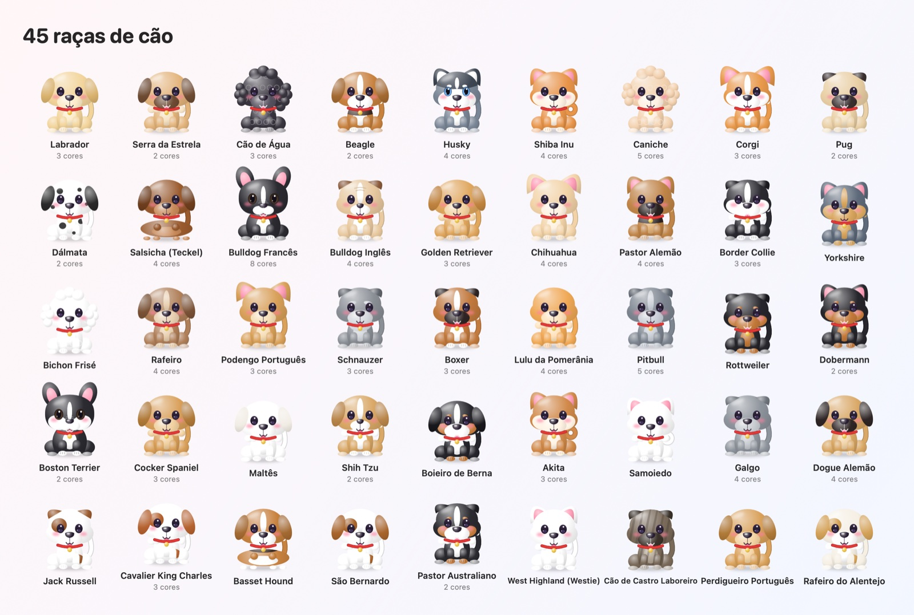</p>

- **Cães — 45 raças**, cada uma nas suas cores reais: Labrador (amarelo, chocolate, preto), Golden Retriever, Bulldog Francês (8 cores), Bulldog Inglês, Pitbull, Rottweiler, Dobermann, Husky, Shiba Inu, Akita, Samoiedo, Corgi, Beagle, Basset Hound, Salsicha, Pastor Alemão, Pastor Australiano, Border Collie, Caniche, Bichon Frisé, Maltês, Shih Tzu, Pug, Chihuahua, Yorkshire, Westie, Jack Russell, Cavalier King Charles, Cocker Spaniel, Boxer, Boston Terrier, Dálmata, Dogue Alemão, Galgo, Boieiro de Berna, São Bernardo, Lulu da Pomerânia, Schnauzer, Rafeiro e as raças portuguesas: Serra da Estrela, Cão de Água, Podengo, Castro Laboreiro, Rafeiro do Alentejo e Perdigueiro.

<p align="center">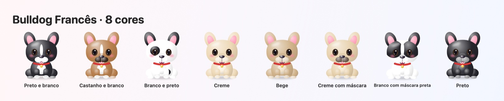</p>

<p align="center">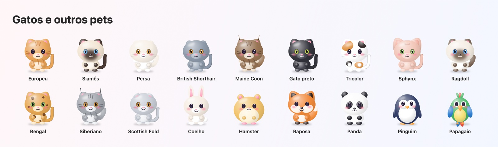</p>

- **Gatos — 12 raças**: Europeu, Siamês, Persa, British Shorthair, Maine Coon, gato preto, Tricolor, Sphynx, Ragdoll, Bengal, Siberiano e Scottish Fold.
- **Outros pets**: coelho, hamster, raposa, panda, pinguim e papagaio.
- **Pelagens especiais** da loja (tigre, galáxia, arco-íris, dourado…) servem em qualquer pet.

Podes mudar a espécie, a raça e a cor quando quiseres em **Aparência**: o nível, os acessórios e o diário mantêm-se.

## 2D ou 3D

Escolhe como os pets são desenhados em **Definições → Aparência → Estilo dos pets** (ou no menu do pet, em **Aparência**). Os pets em 3D são modelos 3D a sério, feitos com as mesmas formas dos desenhos — as mesmas raças, cores, marcas, acessórios e expressões — com luz, sombra e volume. Os truques também ficam iguais: a guitarra, a bola, as bolhas e todos os outros objetos.

<p align="center">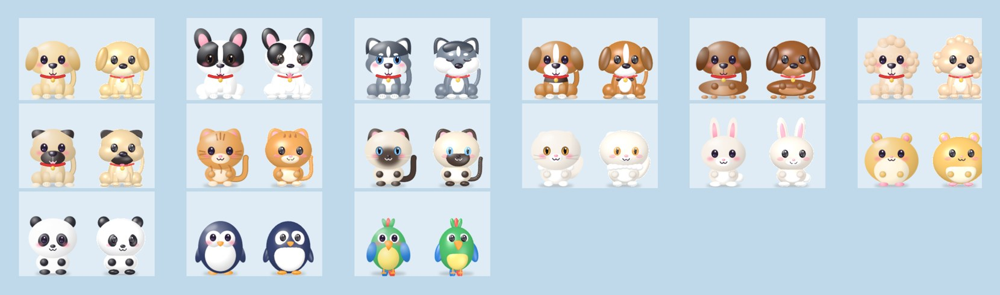</p>

## Truques

<p align="center">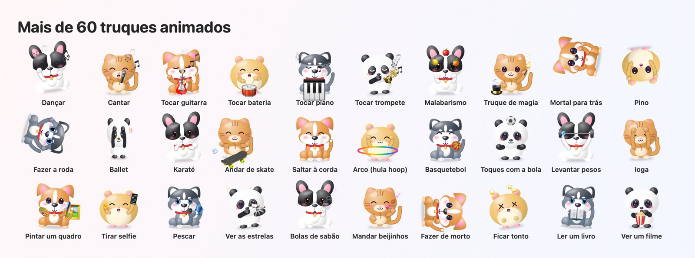</p>

61 truques animados, cada um com os seus movimentos, patas e objetos: dançar, cantar ao microfone, tocar guitarra, bateria, piano e trompete, malabarismo, magia (com um coelho a sair da cartola), mortal para trás, pino, roda, ballet, moonwalk, karaté, skate, saltar à corda, hula hoop, basquetebol, toques com a bola, levantar pesos, ioga, pintar, tirar selfies, pescar, ver as estrelas, bolas de sabão, mandar beijinhos, mais cinco, fazer vénia, pedir, dar a pata, fazer de morto, perseguir a cauda e muitos mais. O pet também faz muitos sozinho, conforme o humor.

## Mini-jogos e moedas

13 mini-jogos: **Apanha a Comida**, **Memória**, **Pedra-Papel-Tesoura**, **Toca no Pet**, **Rebenta Bolhas**, **Corrida**, **Sequência**, **Onde está o pet?**, **Cobrinha**, **Parte-tijolos**, **Jogo do Galo** contra o pet, **Puzzle deslizante** e **Voar**.

<p align="center">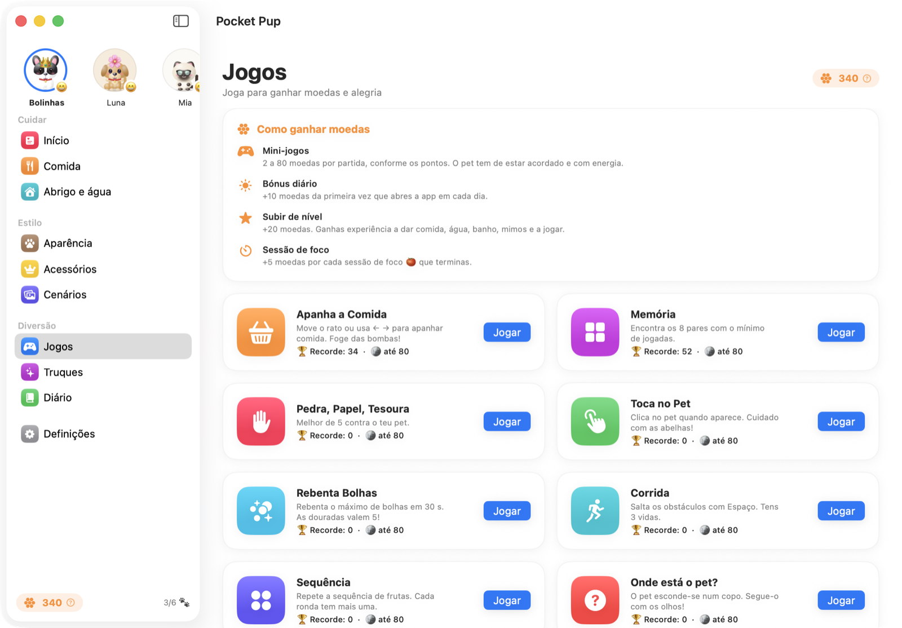</p>

| Como ganhar moedas | |
|---|---|
| Mini-jogos | 2 a 80 moedas por partida, conforme os pontos |
| Bónus diário | 10 moedas da primeira vez que abres a app em cada dia |
| Subir de nível | 20 moedas |
| Sessão de foco | 5 moedas por cada sessão 🍅 terminada |

Gasta-as em comida, acessórios, pelagens especiais, abrigos, cenários, remédios e a adotar mais pets (até 6). Carrega no contador de moedas em qualquer sítio da app para veres a explicação completa.

## A janela Casa

Abre-a no menu do pet, na barra de menus ou com **⌃⌥C**.

<p align="center"></p>

| Secção | |
|---|---|
| **Início** | O quarto com todos os pets e os abrigos, os anéis do estado, o cartão do pet (carrega no nome para o mudar) e as ações rápidas |
| **Comida** | Dar de comer e comprar mais; as favoritas estão assinaladas |
| **Abrigo e água** | A taça de água, os abrigos no ecrã e todos os abrigos para a espécie |
| **Aparência** | Espécie, raça, cor e pelagens especiais |
| **Acessórios** | 48 acessórios para a cabeça, cara, pescoço e mão |
| **Cenários** | 18 fundos para o quarto — e o editor de cenários |
| **Jogos** | Os 13 mini-jogos e como ganhar moedas |
| **Truques** | Pede qualquer um dos 61 truques |
| **Diário** | Tudo o que acontece, dia a dia, e as tuas notas |
| **Definições** | Idioma, tema, atalhos, companheiro, lembretes, música, widgets, atualizações e licenças |

<table>
  <tr>
    <td></td>
    <td>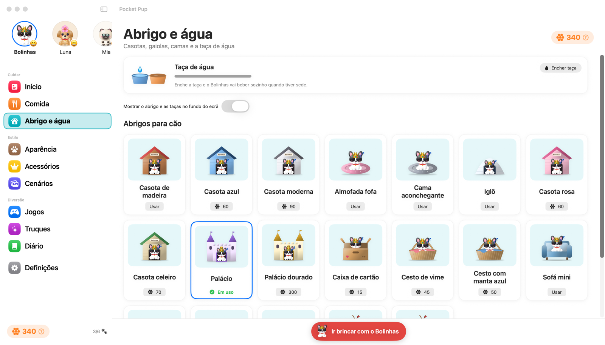</td>
  </tr>
  <tr>
    <td>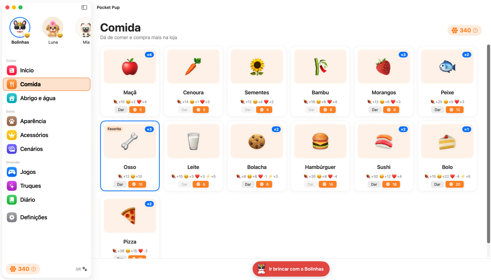</td>
    <td>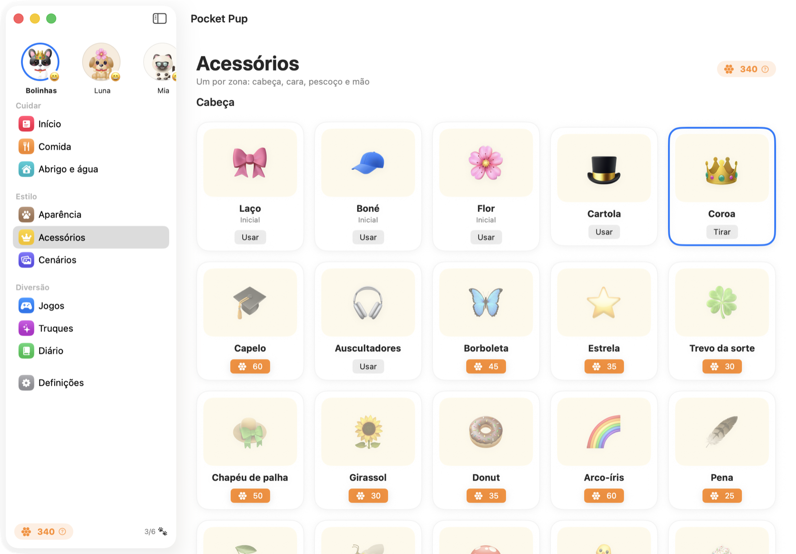</td>
  </tr>
  <tr>
    <td>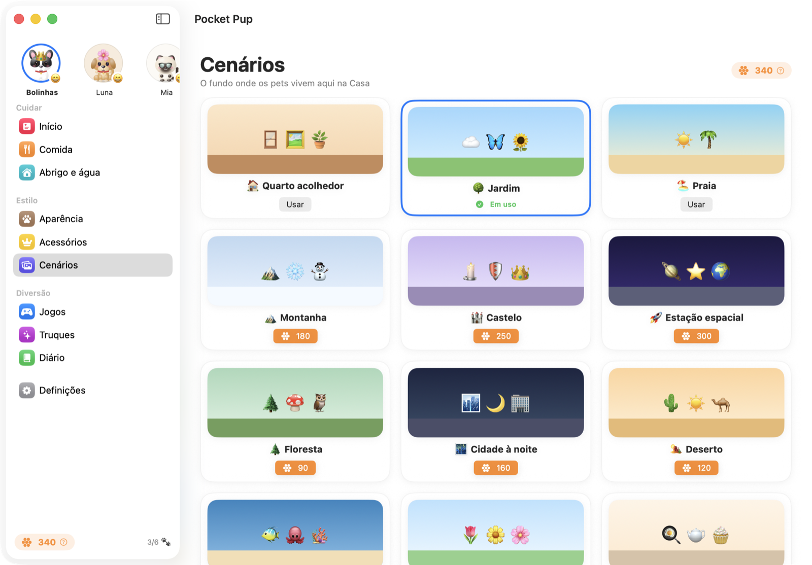</td>
    <td></td>
  </tr>
  <tr>
    <td>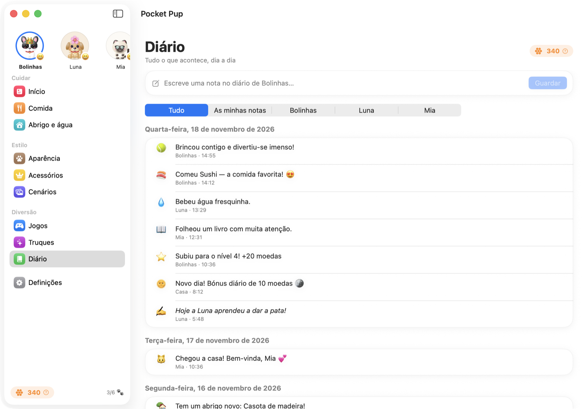</td>
    <td></td>
  </tr>
</table>

A fila de pets no topo da barra lateral arrasta-se para o lado quando tens muitos pets, e **Ir brincar com…**, em baixo, fecha a janela e chama os pets para junto do rato.

Há também um **modo foto** (filtros, molduras e legenda) que guarda fotos do quarto na pasta Imagens.

## Editor de cenários

Arruma o quarto à tua maneira: em **Cenários**, carrega em **Editar o cenário atual**. Arrasta qualquer peça (janela, quadro, plantas…) para onde quiseres, aumenta-a ou diminui-a, apaga-a ou acrescenta peças novas — relógios, candeeiros, livros, uma guitarra, um espelho, balões, arco-íris e mais. **Repor** volta ao cenário original; cada cenário guarda a sua arrumação.

<p align="center">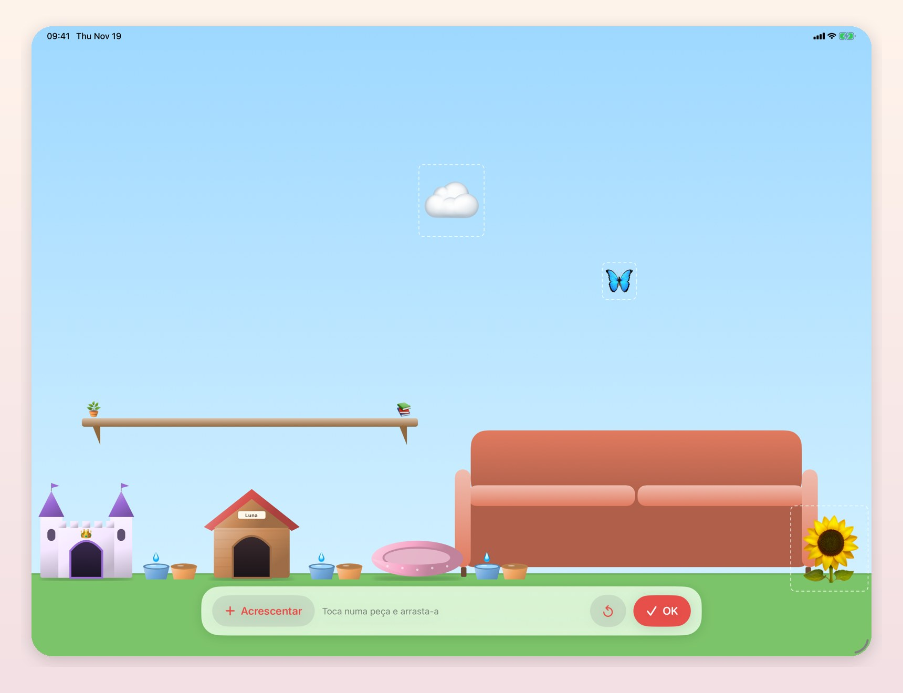</p>

## Modo foco e lembretes

- **Foco** — o pet senta-se a ler ao teu lado enquanto trabalhas (15, 25 ou 50 minutos, com um cronómetro por cima dele) e avisa-te quando é a pausa. Cada sessão terminada dá 5 moedas.
- **Lembrete da água** — de 45 em 45 minutos o pet lembra-te de beberes água também.
- **Widgets de secretária** — um pet animado, o estado de todos os pets e as últimas páginas do diário, na tua secretária.
- **Música do humor** — música suave opcional que muda com o humor do pet.

## Atalhos de teclado

| | |
|---|---|
| **⌃⌥T** | Abrir ou fechar o menu do pet (em qualquer app) |
| **⌃⌥C** | Abrir a janela Casa (em qualquer app) |

Podes mudar os dois em **Definições → Atalhos de teclado**: carrega em **Alterar** e depois na combinação nova (tem de ter ⌘, ⌥ ou ⌃; o Esc cancela).

## Definições

<p align="center"></p>

Idioma (Português / English) · tema (automático, claro, escuro) · estilo dos pets (2D ou 3D) · atalhos de teclado · pets no ecrã · abrigos e taças no ecrã · tamanho do pet · ícone na Dock · lembrete da água · música do humor · widgets de secretária · mudar o nome ou libertar o pet selecionado · sobre e atualizações · créditos e licenças.

## iPhone e iPad

> **Instala-a** com o AltStore ou o SideStore — vê [Instalar no iPhone e no iPad](#instalar-no-iphone-e-no-ipad). Não está na App Store.

O iPhone e o iPad não deixam uma app ficar por cima das outras, por isso no iOS os pets vivem no seu **quarto** dentro da app — e fora dela, nos **widgets**, na **Dynamic Island** e nas **notificações**. O resto é igual ao Mac: a janela Casa, os 13 mini-jogos, os truques, as raças e cores, os acessórios, os cenários, o diário, o modo foto, 2D ou 3D, português e inglês e o modo escuro.

<p align="center">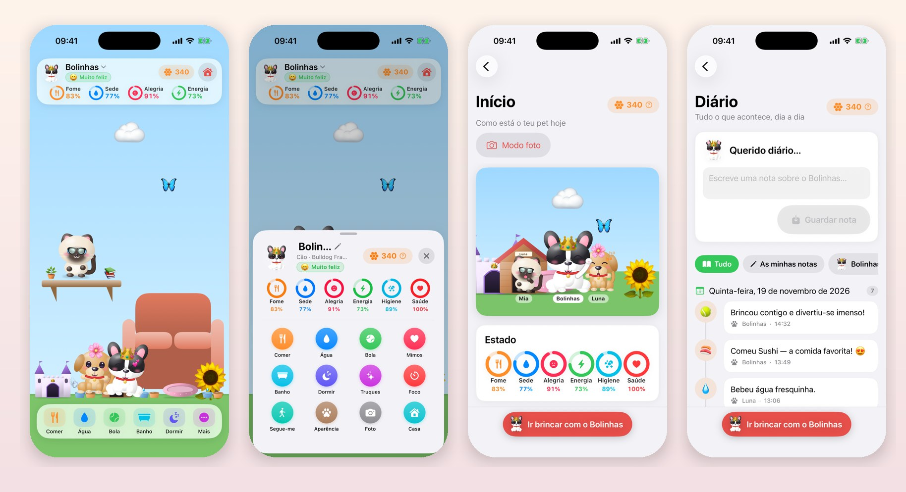</p>

- **O quarto** — os pets passeiam, sobem ao sofá e à prateleira, dormem nos abrigos e bebem das taças. **Toca** num pet para abrir o menu, **toca duas vezes** para lhe fazer mimos, **arrasta-o** para o levar e **atira-o** com o dedo. A barra de cima mostra o humor e as necessidades; a de baixo dá comida, água, bola, banho e põe-no a dormir com um toque.
- **O menu do pet** — as mesmas doze ações do Mac, numa folha.
- **Casa** — todas as secções da janela Casa do Mac. **Ir brincar com…** leva-te de volta ao quarto.
- **Toque e vibração** — todos os mini-jogos se jogam com toques, arrastos e deslizes.

<p align="center">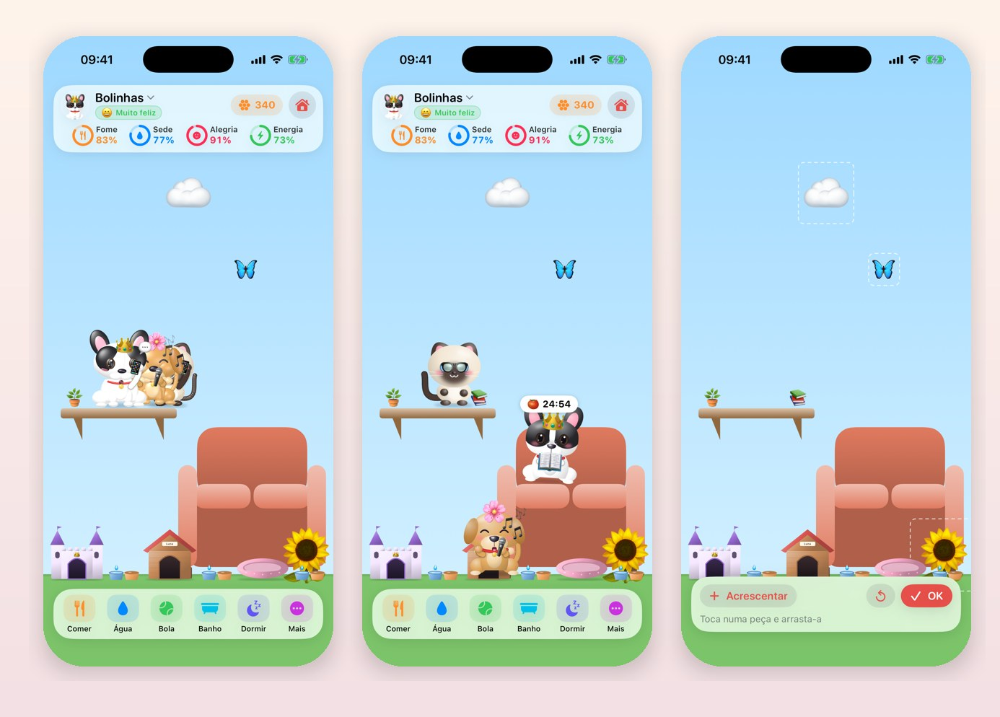</p>

**No iPad**, o quarto e todos os controlos são maiores, e a Casa tem uma barra lateral como no Mac.

<p align="center">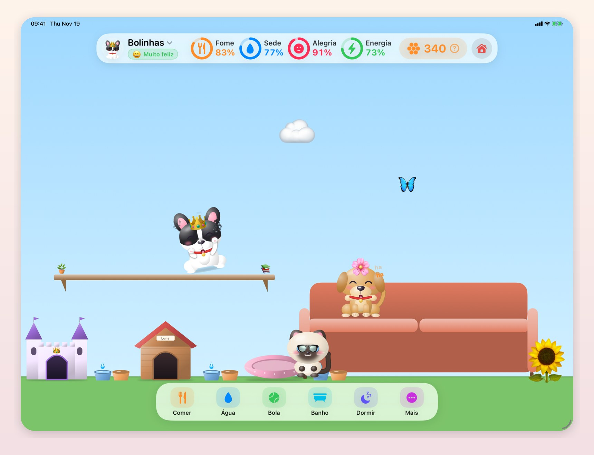</p>

<p align="center">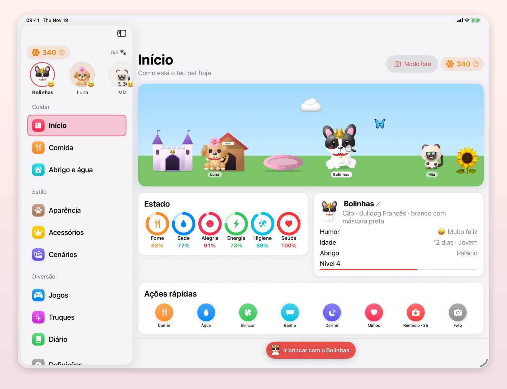</p>

**Widgets, Dynamic Island e notificações**

- **Widgets no ecrã principal** (pequeno, médio e grande) mostram o pet, o humor e as necessidades, com botões para **dar comida**, **água**, **mimos** e **dormir** sem abrir a app. Toca no nome do pet para **escolher outro pet** da lista. Também há widgets para o ecrã bloqueado.
- O **modo foco** mostra a contagem no **ecrã bloqueado** e na **Dynamic Island**.
- As **notificações** avisam quando o pet está a ficar com fome, sede, sono ou sujo, e quando acaba uma sessão de foco (podes desligá-las nas Definições).

<p align="center">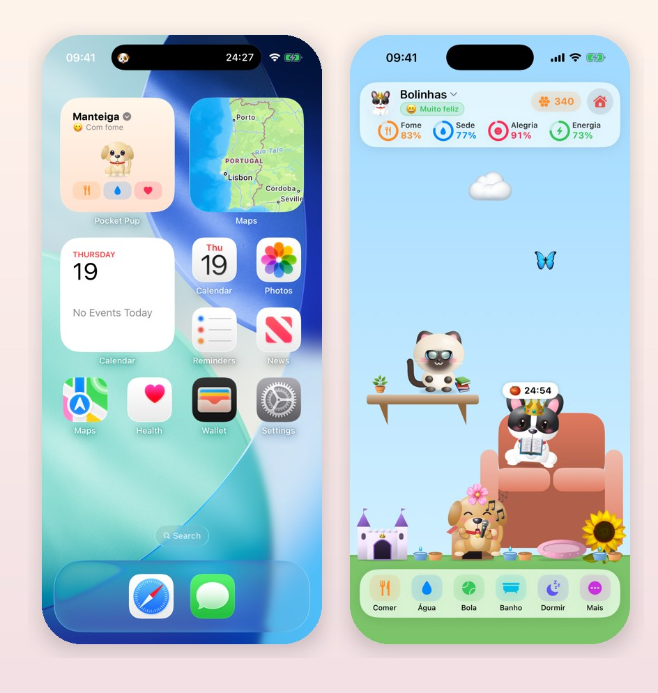</p>

## Privacidade

O Pocket Pup funciona no teu Mac. Não tem conta, nem publicidade, nem estatísticas de utilização.

| Dados | Onde ficam |
|---|---|
| Pets, moedas, diário e definições | Só no teu Mac, em `~/Library/Application Support/Pocket Pup/` (no iPhone e no iPad, só no aparelho, partilhados com os widgets) |
| Fotos que tiras | `~/Pictures/Pocket Pup/` (Imagens) |
| Procura de atualizações | Pede ao GitHub a lista de versões e descarrega a atualização. Não são enviados dados pessoais |

## Resolução de problemas

- **O macOS diz que não pode abrir o Pocket Pup** — instala-o com o comando do Terminal acima, ou vai a **Definições do Sistema → Privacidade e Segurança** e carrega em **Abrir mesmo assim**.
- **O Pocket Pup não abre no iPhone** — a assinatura gratuita expirou ao fim de 7 dias: abre o AltStore › **My Apps** › **Refresh All** (com o AltServer aberto no Mac, na mesma rede Wi-Fi). Os teus pets ficam guardados.
- **O widget do iPhone diz "Ainda não tens um pet"** — abre a app uma vez depois de instalar ou atualizar, para o widget conseguir ler os teus pets.
- **Não consigo passar um abrigo para o outro ecrã** — arrasta o próprio abrigo (não as taças) e larga-o por cima do outro ecrã; ele pousa no fundo desse ecrã.
- **Não vejo o meu pet** — confirma que **Pets a passear no ecrã** está ligado no ícone da barra de menus, ou usa **Chamar os pets para o rato**. Se estiver a dormir, está dentro do abrigo.
- **Não consigo jogar** — o pet tem de estar acordado e com pelo menos 10% de energia.
- **Um atalho não funciona** — outra app pode usar a mesma combinação; muda-o em **Definições → Atalhos de teclado**.
- **Quero começar do zero** — fecha o Pocket Pup e apaga a pasta `~/Library/Application Support/Pocket Pup/`.

## Agradecimentos

O Pocket Pup usa este componente de código aberto (aviso completo em [THIRD_PARTY_NOTICES.txt](../THIRD_PARTY_NOTICES.txt) e na app: **Definições → Créditos e licenças**):

| | | Licença |
|---|---|---|
| [Sparkle](https://sparkle-project.org) | Atualizações automáticas | MIT |

## Sugestões e erros

Encontraste um erro ou tens uma ideia? **[Abre uma issue](https://github.com/jpclopes99/PocketPup/issues)** — os problemas são corrigidos e as novidades chegam em versões novas.

## Marcas registadas

Tamagotchi é uma marca registada da Bandai Co., Ltd. O Pocket Pup é um projeto independente, sem qualquer ligação, aprovação ou patrocínio da Bandai. Apple, Mac e macOS são marcas da Apple Inc., registadas nos EUA e noutros países.

## Licença

**Todos os direitos reservados.** O Pocket Pup é gratuito para descarregar, instalar e usar nos teus Macs, iPhones e iPads, mas **não é código aberto**: o código-fonte não é publicado e não podes copiar, modificar ou redistribuir a app sem autorização escrita do autor. O software é fornecido "tal como está", sem garantias. Os termos completos (em inglês) estão no ficheiro [LICENSE](../LICENSE). Os componentes de terceiros não estão abrangidos e mantêm as suas próprias licenças: [Sparkle](https://sparkle-project.org) (MIT). Vê os [Agradecimentos](#agradecimentos).

© 2026 João Lopes
